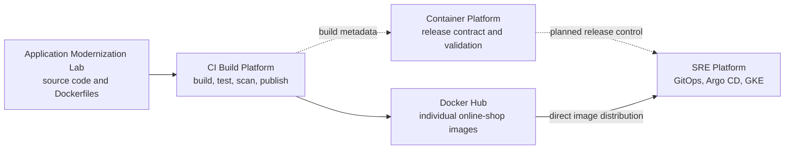

# Container Platform

Container Platform defines the contract for an **Online Shop** release composed of independently built container images. Automated release validation is planned.

The project does not build application code or operate a Kubernetes cluster. Its target workflow turns images published to Docker Hub into a versioned release bundle pinned by digests for review, validation and promotion to the SRE Platform.

> **Status:** Release contract v1 is defined; a digest-pinned baseline candidate and profile inventory are available for review. Automated validation and integrations remain planned.

## Why this platform exists

The Online Shop consists of multiple independently built services. A successful build of each image does not by itself prove that the images form one compatible application release.

The target platform will provide the release boundary below; architecture, the v1 schema, a synthetic example and a discovered baseline candidate are available:

- defines which images and immutable digests make up a release;
- validates that the release is complete and follows container-release rules;
- provides a local Compose-based integration harness for the published images;
- hands an approved release to the SRE Platform for GitOps deployment.

## Platform ecosystem

The two paths into the SRE Platform have different roles:

- Docker Hub is the data path: Kubernetes nodes pull the approved images from `dmitryzhuravlev/online-shop-*`.
- Container Platform is the release-control path: it identifies the exact image digests that are approved together as one Online Shop release.

The diagram describes target relationships. Registry checks, the validator, Compose integration and SRE handoff are planned, not implemented.

## Responsibilities

| Component | Owns | Does not own |
|---|---|---|
| Application Modernization Lab | Online Shop source code, Dockerfiles, instrumentation | image distribution or runtime deployment |
| CI Build Platform | per-service build, tests, scans, source/build metadata, Docker Hub publication | release approval or Kubernetes deployment |
| Container Platform | release manifest, release-policy validation, published-image integration checks | application source, image builds, a long-lived environment, or Kubernetes deployment |
| SRE Platform | environment-specific GitOps configuration, rollout, rollback, observability, and runtime operation | rebuilding or retagging the approved release |

## Planned release lifecycle

1. CI Build Platform builds and publishes individual Online Shop images to Docker Hub.
2. A full release manifest records immutable digests and per-component source/build references under the contract, with explicit legacy gaps and separate third-party dependency rules.
3. Container Platform validates the manifest and the published image references through pull-request checks.
4. A release PR may represent approval only after authorized review and all documented mandatory checks pass; merge alone is not validation. These gates are not implemented yet.
5. A promotion change updates the SRE Platform's GitOps configuration to the exact digests from that release.
6. Argo CD applies the GitOps change, and GKE pulls the same images from Docker Hub.

Container Platform does not sit in the network path between GKE and Docker Hub. It improves the decision and audit path **before** deployment.

## MVP scope

The first MVP will provide:

- a machine-readable Online Shop release manifest;
- immutable Docker Hub digest references for all required services;
- deterministic release-policy checks;
- Docker Hub availability verification;
- a Compose-based validation path that uses published images rather than local builds;
- a documented, reviewable handoff to the SRE Platform;
- a rollback model based on selecting a previously approved release.

The MVP intentionally excludes a new registry, a Kubernetes cluster, a long-lived development or staging environment, and automatic deployment.

## Related projects

- [Application Modernization Lab](https://github.com/DimitryZH/application-modernization-lab)
- [CI Build Platform](https://github.com/DimitryZH/ci-build-platform)
- [SRE Platform](https://github.com/DimitryZH/sre-platform)
- [Docker Hub profile](https://hub.docker.com/u/dmitryzhuravlev)

See the [roadmap](docs/roadmap.md) for the planned implementation sequence.

## Release Contract artifacts

- [Architecture](docs/architecture.md)
- [Canonical release contract](docs/release-contract.md)
- [Version 1 JSON Schema](schemas/release-v1.schema.json)
- [Non-deployable synthetic example](examples/release-v1.example.json)

The existing Dockerfiles and build/push scripts are empty, and Compose contains local-build placeholders. Their disposition is documented in the architecture; they are not a working release pipeline.

## Baseline candidate

See the [baseline discovery](docs/baseline.md), [profile inventory](inventories/online-shop-sre-dev-v1.json), [candidate](releases/baseline-2026-10-18.json), and [registry observations](releases/baseline-2026-10-18.observations.json). The selected dev profile includes 10 application services, Redis and a load generator. These namespace-published artifacts are third-party upstream copies/dependencies with legacy traceability gaps; this candidate is not approved or deployment-authorized.
