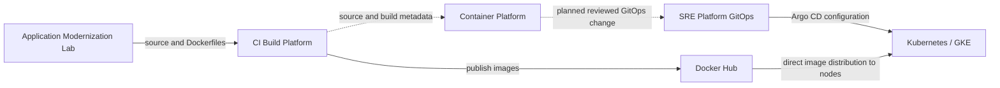

# Architecture

Container Platform defines the release boundary for Online Shop, based on Online Boutique / microservices-demo. The repository defines architecture and a contract, with a [discovered baseline candidate](baseline.md); executable validation and integrations remain planned.

## Target responsibilities and trust boundaries

| Owner | Responsibility |
|---|---|
| Application Modernization Lab | Application source, Dockerfiles, application changes and instrumentation |
| CI Build Platform | Independent image builds, tests, scanning, publication and source/build metadata |
| Docker Hub | Public image storage and distribution |
| Container Platform | Release composition, immutable references, release policy, integration evidence and container-release review |
| SRE Platform | Environment-specific GitOps, Argo CD, Kubernetes/GKE, rollout, runtime observability and operational decisions |

Solid image-distribution arrows and the dashed release-control path have different purposes. Container Platform is not a network proxy: Kubernetes pulls directly from Docker Hub. The diagram describes target relationships, not completed integrations. Future first-party application builds use exact allowlisted entries in the public `dmitryzhuravlev/online-shop-*` naming family. Namespace alone does not establish ownership: the discovered baseline contains upstream copies and a Redis dependency classified as third-party.

No Container Platform cluster or permanent dev/stage environment is required. Future bounded local/CI Compose checks will consume published images. Secure Delivery Platform uses Artifact Registry and has Astronomy Shop as its future workload; that integration is outside this MVP.

## Decisions and evidence

The [release contract](release-contract.md) is canonical for manifest fields and rules. Structural validation, policy/registry checks, integration evidence, container-release approval, SRE environment authorization, and deployment/runtime evaluation are separate stages. None is implied by the preceding stage alone.

SRE will select a manifest at an immutable Container Platform Git commit and review a GitOps change using exactly its image set. Matching SRE values, mandatory checks and protected merges are future work; manual deviations are not technically prevented today. Environment authorization and runtime evaluation belong to SRE.

## Existing scaffold and disposition

`services/` currently contains five empty Dockerfiles; this is not a verified service inventory. `scripts/build-all.sh` and `scripts/push-all.sh` are empty. The root `docker-compose.yaml` uses local builds, mutable `dev` tags and `<username>` placeholders. It cannot serve as release integration evidence.

These files remain unchanged in this milestone. Application Dockerfiles and build/publish ownership belong to Application Modernization Lab and CI Build Platform respectively. A later scoped change will retire or relocate obsolete scaffold after confirming consumers, and replace the Compose placeholders with a published-image harness once the baseline inventory is established. No service count or runnable baseline is inferred from these files.
